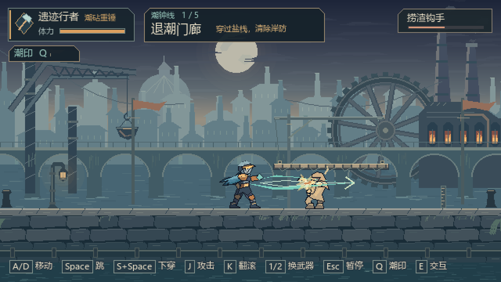

# 余烬回廊

一款以潮汐侵蚀的铸造城为舞台的原创 Python 横版动作 Roguelite。首个手工关卡「潮钟线」从退潮门廊通往潮钟熔庭。带上弯刃和重锤，穿过五间厂房，扳开高处的绞盘，击败守钟人并敲响退潮钟。



## 在本机开始

已有项目虚拟环境时，在项目目录的 PowerShell 中执行以下命令。首次从 GitHub 克隆，请先按下方「在另一台 Windows 电脑安装」创建环境。

```powershell
.\.venv\Scripts\python.exe -m game
```

| 操作 | 按键 |
| --- | --- |
| 开始潮钟线 | 标题页按 Enter |
| 左右跑动、空中调整方向 | A / D |
| 跳跃 | Space，轻点低跳，按住高跳 |
| 从悬吊栈板下穿 | 按住 S 再按 Space |
| 朝当前方向翻滚 | 在地面或平台上按 K；梁下保持方向可低身移出 |
| 攻击 | J。弯刃连按三次可依次横斩、上挑、突刺；重锤按一次蓄势落锤 |
| 切换已持有的武器 | 1 余烬弯刃，2 潮砧重锤，动作收势后可换装 |
| 施放潮印 | Q。朝前释放短波，命中敌人或消去弩弹。体力栏下方显示冷却 |
| 开门、扳绞盘、鸣钟 | 靠近装置按 E。清除本室守卫后由东门过境，回复 18 体力 |
| 暂停 / 继续 | Esc |
| 调节反馈 | 战斗暂停时用 F1–F4 分别调节震动、闪光、音量、粒子。每项四档，当前进程内有效 |
| 再战 | 死亡或胜利结算后按 R，从第一室重新出发 |

拖动窗口边缘可调整大小，使用窗口关闭按钮退出。游玩时可离线。

只想练习跳跃、下穿和翻滚时，运行 `.\.venv\Scripts\python.exe -m game --practice`。

原版盐炉渡口三敌交锋可用 `.\.venv\Scripts\python.exe -m game --skirmish` 单独游玩。

## 在另一台 Windows 电脑安装

安装 64 位 Python 3.12 和支持 OpenGL 3.3 的图形驱动。在项目目录创建新的虚拟环境。首次安装依赖需要联网。

```powershell
py -3.12 -m venv .venv
.\.venv\Scripts\python.exe -m pip install -r requirements.txt
.\.venv\Scripts\python.exe -m game
```

需要本机安装微软雅黑、等线或黑体中的一种。已在 Windows 11、Python 3.12.14、Arcade 3.3.3 和 Pillow 11.3.0 下验证。[Arcade 3.3.3 安装说明](https://api.arcade.academy/en/3.3.3/get_started/install.html)

## 继续开发

- [开发日志](docs/DEVLOG.md) · [潮钟线实机回放](docs/verification/stage4/route.gif)

- [项目状态与复验方式](docs/PROJECT_STATE.md)
- [盐炉渡口同机位前后对照与帧耗时](docs/verification/visual/RESULTS.md) · [并排动作回放](docs/verification/visual/comparison.gif)
- [长期项目原始规范](docs/PROJECT_BRIEF.md) · [阶段路线图](docs/ROADMAP.md)
- [美术与动画约定](docs/ART_GUIDE.md) · [资源来源](assets/manifest.json)
- [阶段 3 实机战斗回放](docs/verification/stage3/combat.gif) · [命中与中断记录](docs/verification/stage3/combat.json)
- [阶段 2 实机往返回放](docs/verification/stage2/route.gif)
