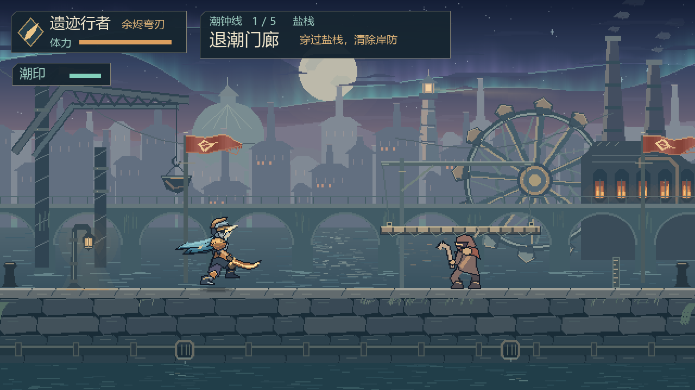

# 余烬回廊

一款以潮汐侵蚀的铸造城为舞台的原创 Python 横版动作 Roguelite。潮钟线从退潮门廊通往潮钟熔庭，每局途经的厂房顺序和地形由种子决定。带上弯刃和重锤，穿过五间厂房，扳开高处的绞盘，击败守钟人并敲响退潮钟。



[五间厂房的动态实景与同机位前后对照](docs/verification/harbour/comparison.gif) · [开发日志](docs/DEVLOG.md)

[下载 Windows 试玩包](https://github.com/yushdh/ember-corridor/raw/refs/tags/playtest-gallery-soak/EmberCorridor-Windows-x64.zip) · [种子 17 连续过门、重开与长帧实测](docs/verification/gallery-soak/README.md) · [西侧绞盘录屏与不录屏的长帧对照](docs/verification/frame-pacing/README.md) · [低特效 30 / 60 帧收刀翻滚实录](docs/verification/low-cadence/README.md) · [烈焰与双敌预警](docs/verification/flame-crossfire/README.md) · [回钩与弩箭交叉](docs/verification/crossfire/README.md) · [回链绞工单独交锋](docs/verification/return-chain/README.md) · [炉件装配预览与实测](docs/verification/forge-preview/README.md) · [手工五室短刃折返验收](docs/verification/stage4-detour/README.md)

[栈板下穿、头顶血条与新版刀锤试听](docs/verification/deck-foley/README.md) · [蓄满提示与敌方预警](docs/verification/charge-signal/README.md) · [持械动作与近战命中](docs/verification/quay-strike/README.md)

## 在本机开始

想在 30 帧下试收刀翻滚，解压后运行 `.\EmberCorridor.exe --seed 17 --fps 30`。源码启动命令为 `.\.venv\Scripts\python.exe -m game --seed 17 --fps 30`。在设置中把闪光与震动调到 0、粒子调到 1；将启动参数里的 30 改为 60 可对照游玩。

想遇到回链绞工，解压后运行 `.\EmberCorridor.exe --seed 17`。离开第一室，在司钟吊廊的西侧绞盘入口可以看见他背上的铜卷筒。等钩齿张开、链条绷直，朝绞工翻滚，趁他垂手收具时转身出刀。[躲过回钩并反击的实机动图](docs/verification/return-chain/duel.gif)

想重走已验收的随机潮图 6108，在解压目录运行 `.\EmberCorridor.exe --seed 6108`。离开门廊后依次经过双闸涵洞、东西泵台和西侧绞盘。[实机画面与落点记录](docs/verification/stage6/seed-6108/README.md)

### 首次试玩手工五室

解压本轮 `dist/forge-preview/EmberCorridor-Windows-x64.zip`，双击 **首次试玩.cmd**。它会用独立新档打开经典五室；源码入口为 `.\.venv\Scripts\python.exe -m game --first-play`。按游戏内提示自由游玩，离席时可按 Esc 暂停，通关或随时关窗均可结束。若愿意反馈，打开资源管理器的 `%LOCALAPPDATA%\EmberCorridor-Playtests`，取最近目录中的 `session.json`，并说明是否第一次玩以及最难找路或最难应对的地方。试玩记录只保存在本机。[本轮验证和计时口径](docs/verification/stage4-first-play/README.md)

### Windows x64 发行包

解压完整的 `EmberCorridor-Windows-x64.zip`，双击其中的 `EmberCorridor.exe`。请保留同目录的 `_internal`。发行包自带 Python 和游戏依赖，中文使用系统字体。在解压目录打开 PowerShell，运行 `.\EmberCorridor.exe --seed 17` 可重走本轮验收路线。存档沿用源码版的 `%LOCALAPPDATA%\EmberCorridor`。

从源码构建时，在项目虚拟环境内执行下列命令。生成的 ZIP 位于 `dist\EmberCorridor-Windows-x64.zip`。[发行说明](docs/WINDOWS_RELEASE.md) · [实机验收](docs/verification/stage8/README.md)

```powershell
.\.venv\Scripts\python.exe -m pip install -r requirements-build.txt
.\.venv\Scripts\python.exe tools/build_windows.py
```

### 源码版

想遇到新守卫「探潮叉手」，用 `.\.venv\Scripts\python.exe -m game --seed 17` 开局。它守在第四室双闸涵洞入口，压低长叉后会刺向脚踝。等叉尖放平再跳，落地后有时间回一刀。[实机交锋](docs/verification/stage7/duel.gif)

已有项目虚拟环境时，在项目目录的 PowerShell 中执行以下命令。首次从 GitHub 克隆，请先按下方「在另一台 Windows 电脑安装」创建环境。

```powershell
.\.venv\Scripts\python.exe -m game
```

| 操作 | 默认按键 |
| --- | --- |
| 开始潮钟线 | 标题页按 Enter |
| 左右跑动、空中调整方向 | A / D。地面奔跑消耗左上琥珀色耐力条，停步恢复；耗尽时改为慢跑，恢复到 30 可再次全速奔跑 |
| 跳跃 | Space，轻点低跳，按住高跳 |
| 从悬吊栈板下穿 | 按住 S 再按 Space，或近乎同时按下两键 |
| 朝当前方向翻滚 | 在地面或平台上按 K；梁下保持方向可低身移出 |
| 攻击 | J。弯刃连按三次可依次横斩、上挑、突刺；重锤按一次蓄势落锤 |
| 切换已持有的武器 | 1 余烬短刃，2 潮砧重锤。动作收势后可换装，图标旁短暂显示武器名 |
| 施放潮印 | Q。朝前释放短波，命中敌人或消去弩弹。生命条下方显示冷却 |
| 弯刃蓄焰斩（潮钟线） | 在地面持弯刃按住 L 约 0.45 秒，刀光骤长后松手挥斩；提前松开可收刀。 [实机动图](docs/verification/firecut/firecut.gif) |
| 开门、扳绞盘、鸣钟 | 靠近装置按 E。清除本室守卫后由东门过境，回复 18 生命 |
| 开匣装配 | 前四室清场后，东门前会出现炉料匣。靠近按 E，按界面上的 1 / 2 / 3 装配，Esc 可稍后再取 |
| 暂停 / 继续 | Esc。用 ↑ ↓ 选择角色、设置或操作说明，Enter 确认，Esc 返回。暂停页下方可查当前目标 |
| 操作说明与改键 | Esc 暂停后按 F5，上下选择动作、Enter 录入新键、Esc 返回。再次按 Esc 继续 |
| 重看教程 | 暂停后按 F6，立即回到游戏，按当前绑定重新提示 |
| 调节反馈 | 战斗暂停时用 F1–F4 分别调节震动、闪光、音量、粒子。每项四档，自动保存，潮钟线和原版交锋共用 |
| 再战 | 死亡或胜利结算后按 R，从第一室重新出发 |

拖动窗口边缘可调整大小，使用窗口关闭按钮退出。游玩时可离线。

地名只在本局首次进入该区域时出现。房间目标和守卫进度会在取得或变化后短暂显示。左上长金条为耐力，砖红短条为生命，青色细条为潮印冷却。[新版 HUD 对照](docs/verification/hud/comparison.png) · [进入退潮门廊到暂停的 720p 录屏](docs/verification/hud/entry-to-pause.mp4)

首次进入门廊后，下方短暂提示移动。接近可跳台面、近战目标和敌人前摇时才会提示对应动作。每条本局最多出现一次，成功做过的动作会记入存档。重看只影响当前教学，不会清空已有掌握记录。[开局实机录屏](docs/verification/onboarding/tutorial.mp4) · [同机位画面对照](docs/verification/onboarding/comparison.png)

### 炉件与存档

**重走一张潮图。** 默认开局及结算或死亡后按 R 都会抽取种子。标题页、暂停页和结算画面可查看种子。进入游戏后，本局种子、生成器版本、使用的五个模板与是否启用备用路线保存在 `%LOCALAPPDATA%\EmberCorridor\last-route.json`。这是路线记录，人物仍从门廊出发。

| 想玩的路线 | PowerShell 启动命令 |
| --- | --- |
| 新随机潮图 | `.\.venv\Scripts\python.exe -m game` |
| 固定种子 17，按 R 也重走此图 | `.\.venv\Scripts\python.exe -m game --seed 17` |
| 原版手工五室 | `.\.venv\Scripts\python.exe -m game --classic` |

种子 17 先到西侧绞盘，再走高架检修桥和双闸涵洞。门廊与最后的退潮钟固定。当前版本中相同种子可复现房间顺序、地形、守卫和机关位置。[阶段 6 实机记录](docs/verification/stage6/README.md)

每个匣可选一件。用 ↑ ↓ 比较当前武器首击、潮印冷却和固定减伤，Enter 装配，Esc 可退出再选。重复选同款可升阶，换款会保留本局已投入的阶数，仅身上这一款生效。赤铜刃齿加强近战，回潮轮缩短 Q 的冷却。首次装配会解锁覆炉甲片，下次出发即可选择减伤。过门保留装备，死亡或胜利后按 R 开始新局，炉件阶数清零。[装配实机截图](docs/verification/stage5/blueprint.png)

永久炉谱与四项反馈设置保存在 `%LOCALAPPDATA%\EmberCorridor\profile.json`，同目录的 `profile.bak` 保存上一次有效数据。每次更改会自动写入。主文件损坏时游戏尝试恢复备份并显示提示。如果两份都无法读取，可以继续本次游玩；修复时先关闭游戏，另存整个目录，再放回有效备份或移走损坏文件重新开始。从新版本生成的存档请使用对应版本打开。局内房间和战斗进度仅在本次游玩中保留。

只想练习跳跃、下穿和翻滚时，运行 `.\.venv\Scripts\python.exe -m game --practice`。

原版盐炉渡口三敌交锋可用 `.\.venv\Scripts\python.exe -m game --skirmish` 单独游玩。

## 在另一台 Windows 电脑安装

安装 64 位 Python 3.12 和支持 OpenGL 3.3 的图形驱动。在项目目录创建新的虚拟环境。首次安装依赖需要联网。

```powershell
py -3.12 -m venv .venv
.\.venv\Scripts\python.exe -m pip install -r requirements.txt
.\.venv\Scripts\python.exe -m game
```

需要本机安装微软雅黑、等线或黑体中的一种。已在 Windows 11、Python 3.12.14、Arcade 3.3.3 和 Pillow 11.3.0 下验证。[Arcade 3.3.3 安装说明](https://api.arcade.academy/en/3.3.3/get_started/install.html)

## 继续开发

- [本轮视觉与打击感并排实机回放](docs/verification/forge-visual/comparison.gif) · [命中、预警和帧耗时](docs/verification/forge-visual/RESULTS.md)

- [开发日志](docs/DEVLOG.md) · [潮钟线实机回放](docs/verification/stage4/route.gif)

- [项目状态与复验方式](docs/PROJECT_STATE.md)
- [盐炉渡口同机位前后对照与帧耗时](docs/verification/visual/RESULTS.md) · [并排动作回放](docs/verification/visual/comparison.gif)
- [长期项目原始规范](docs/PROJECT_BRIEF.md) · [阶段路线图](docs/ROADMAP.md)
- [美术与动画约定](docs/ART_GUIDE.md) · [资源来源](assets/manifest.json)
- [阶段 3 实机战斗回放](docs/verification/stage3/combat.gif) · [命中与中断记录](docs/verification/stage3/combat.json)
- [阶段 2 实机往返回放](docs/verification/stage2/route.gif)
