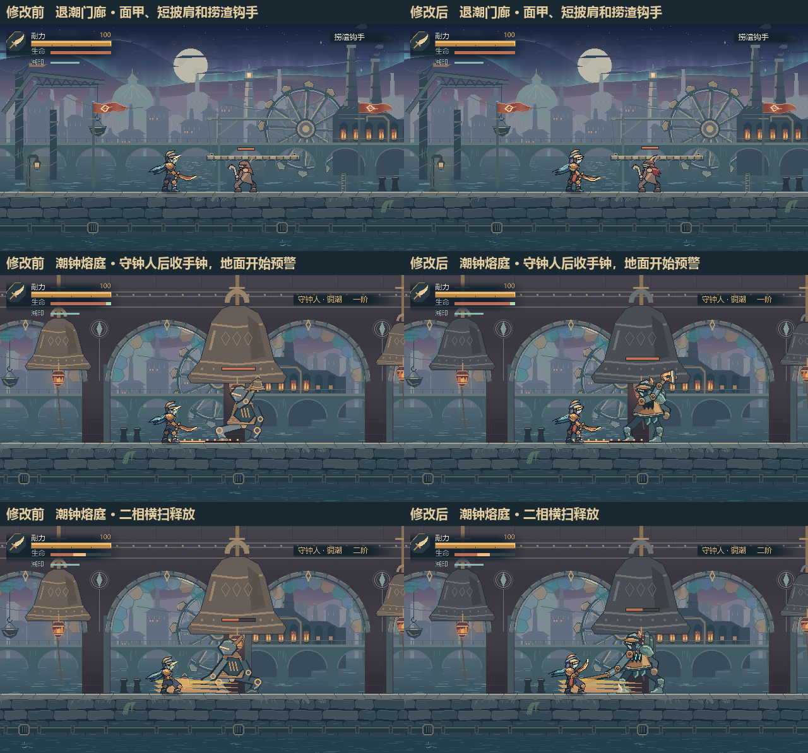

# 盐炉铸装 · 行者、五类守卫与守钟人

[同机位前后短片，左旧右新](duel-comparison.mp4) · [修复前原片](before.mp4) · [修复后原片](after.mp4) · [强特效实机原图](fire-warning.png) · [五类守卫与 Boss 的前摇](guards.png)

每格保留完整的 640×360 世界视野。以下为 1280×720 窗口直接读回的 PNG，可单独打开看面甲和手钟。

| 取样 | 修改前 | 修改后 |
| --- | --- | --- |
| 门廊的行者与钩手 | [原图](before-gate-10.png) | [原图](after-gate-10.png) |
| 守钟人后收手钟 | [原图](before-boss-sweep-warn-1.png) | [原图](after-boss-sweep-warn-1.png) |
| 二相横扫出手 | [原图](before-boss-sweep-active-2.png) | [原图](after-boss-sweep-active-2.png) |

## 从实机定位

原版门廊里，披肩数条平行的亮边容易并入身后的栈板和水面。钩手的头和肩色值接近，准备抬钩时靠图标更容易读招。熔庭里手钟举到背景吊钟下沿时，两处铜色与轮廓尤其容易相接。按正常视距检查，原版已经使用最近邻和整数投影；动作定格仍能辨认像素，没有观察到需要换分辨率才能解决的模糊。取样中的 Boss、主角和危险区可以在同一镜头里看全。

## 做了哪些像素与动画改动

| 对象 | 美术与接入 |
| --- | --- |
| 遗迹行者 | 封闭面甲以盔脊、暗眼缝与下颌分面指示朝向。雾蓝肩布改成宽折面和短翻边，赭红腰片从皮带下摆动。髋部跟随发力方向，脚底仍用统一支撑点。短刃有独立刃脊，近手护臂与肩片分层。原先受击和倒地时空手，现在刀、锤分别跟随手腕；倒地八帧改变膝、脚、腕与躯干姿势。 |
| 钩手、弩手、重卫 | 用缺齿盔与赤褐护领读出钩手的朝向，前摇两拍先收手再上举。弩手露出箭匣、弩弦与短弩托，重卫用铰链肩甲与厚盾面。 |
| 叉手、绞工 | 叉手的宽斗笠、油布披领和低位双齿叉构成一条斜线。绞工的卷筒露出绳槽与曲柄，握钩手与背部机构分开。五类各有 14 个不同姿势，行走增加交替提靴的经过姿势；死亡有失衡、落膝、伏地三段，伏地后逐渐退场。 |
| 守钟人 | 原创独立 224×148 单元，脚底锚点 (69,132)，两相各 19 个姿势。钟壳胸甲、护胫活塞、垂下的配重手与持钟手分层。低扫有收槌、发力、甩出、回落，危险地面宽度随实际阶段取值。半血开启背阀、露出通气槽，远扫的钟头随之伸出。血条按最高举槌姿势留白。受击只在收势或待机时短促扣肩；变相、出招、死亡优先。通气槽不参与伤害判定。 |
| 特效与场景 | 蓄焰刃内部增加烧黑的刀槽，削减刀光外围零散火星。横扫地面冲起碎片，喷潮的分股之间留出空隙。熔庭装饰吊钟压低至冷灰，保留原有的环境和镜头。震动、闪光、粒子及音量沿用原设置。 |

项目目前有五类普通守卫和一名两相 Boss，尚无独立精英变体。所有新增像素由项目的 Python/Pillow 绘图程序在透明 RGBA 单元内原创生成。参考图用于比较正常视距下的明暗和轮廓，没有取用其中角色或游戏资产。来源、处理方式及许可依据逐项登记在[资源清单](../../../assets/manifest.json)。

## 运行和回归

- 四段固定机位的游戏回放使用种子 17 和正常战斗更新，按测试标记安排初始站位。为可重复拍到二相，熔庭对照片在指定步把 Boss 设到半血，由正式 AI 触发变相。独立的完整路线另从开局打到 Boss、胜利、死亡及重开。20 个同机位快照的逻辑步、主角位置、相机、朝向、状态、血量以及四段战斗的事件序列前后完全相同。[回放事件](matched.json) · [打磨期间的完整路线](campaign.json) · [最终解压版五室路线](installed.json)
- MP4 由实际窗口每隔三个 60 Hz 更新采一帧，每秒播放 20 帧，长 7.70 秒，无音轨。前段可见行者待机、跑动、受击与出刀，后段为熔庭交锋。取证画面包含独立绘制的 HUD。
- 另用正式窗口按帧显示五类守卫、两相 Boss 和刀锤受击与死亡，左右朝向共 260 项；核对实际选中的纹理、透明通道、画布边缘与敌方脚底。守卫展示图使用明确设置的姿势。两种武器、两种朝向的移动动作共 24 组逐帧覆盖。第一次实时跑动采样漏了右向奔跑的后四帧，随后在独立窗口按固定步连续送入按键，八帧均实际播放。[姿势记录](pose-audit.json) · [移动播放记录](movement.json)
- 刀或锤的四种攻击都在第 3 号有效帧命中，命中去重与刀光开关检查通过。蓄焰斩 14 帧均实际进入游戏，刀锤接触各播放三帧。种子 17 双敌交叉下关闭震动、闪光，粒子一档，30 与 60 FPS 均在第 332 步起滚并满血完成反击，过早按键对照剩余 82 生命。[武器与命中](weapon-events.json) · [低特效交锋](low-effects.json)
- Windows 11，Python 3.12.14、Arcade 3.3.3、RTX 5060 Laptop GPU，1280×720，640×360 世界缓冲。同一台机器依次运行旧、新、新、旧四个独立进程，每版测 1,292 个热身后样本。关闭垂直同步；每帧从更新开始计到绘制和 GPU 同步结束，排除截图、编码、限速等待和换帧。中位数 **1.113 → 1.109 ms**，P95 **4.111 → 4.133 ms**，样本最大值 **6.956 → 7.210 ms**。这组数据用于比较这四段场景的工作耗时；低配设备、长帧发生率和端到端显示延迟未验证。[逐帧原始数据](timings.json.gz)
- 手工五室真人首玩继续单列待验收，记录为 0。真实玩家在拥挤场景能否更早认出攻击仍待观察。此前连续重开中记录的偶发绘制长帧未在本轮长测复核。

## 图集回归

首次 Windows 包实走五室后，共享图集由 4096×6144 扩成 8192×12288。最终加载器只对清单标记的角色动作裁去透明外缘，189 个单元的矩形像素总数从 3,725,056 降为 1,017,492；这个计数不含图集填充与显存的其他用途。逐帧还原画布和两向握点均相符。链箍增加透明行以保持整数边缘。在使用相同链箍的两个版本上，裁边前后 34 张游戏窗口 PNG 逐像素相同。[原始面积及 34 个样本](atlas-cells.json)

## 改动文件与复现

在裁掉透明边后，旧排布仍可能在完整路线中扩容。最终战役图集使用 8192×4096，在本机名义 RGBA8 容量为 128 MiB，较上一版启动时增加 32 MiB。独立解压的最终 EXE 在 30 FPS 下从门廊走到守钟人，通关、死亡和两次重开后仍为 8192×4096。测试时 PATH 仅含 Windows 系统目录。随包的 62 项资源逐项核对过文件内容，61 项单元测试通过。试玩 ZIP 的 SHA-256 为 `4eb9817da00618cce5ebb79b11acab5ad37b26fafd3b9f95b04f89f42d4ac0fb`。[最终发行包验证](installed.json)

- 移动、翻滚、持械及五类守卫的生成器为 `tools/draw_walker.py`、`tools/roll_pose.py`、`tools/draw_combat.py`。成品为 `assets/walker/` 六张动作表及 `clips.json`、`assets/combat/walker.png`、`watch.png`、`clips.json`。
- 守钟人由 `tools/draw_bellkeeper.py` 绘制，经 `tools/draw_foundry.py` 导出 `assets/foundry/bell.png`、`bell_tide.png`。同目录更新了 `room-5.png`、`effects.png`、`cast.png`、`firecut.png`、`fire-ignite.png`、`firelight.png` 和 `clips.json`。蓄焰绘制位于 `tools/draw_flame.py`。
- 游戏接入在 `game/battle_view.py`、`game/campaign.py`、`game/foundry.py`、`game/resources.py`、`game/window.py`。从源码启动可用 `.\.venv\Scripts\python.exe -m game --seed 17`。复拍可用 `.\.venv\Scripts\python.exe tools/verify_cast.py build/my-cast --audit`，加 `--encoder <ffmpeg.exe 路径>` 导出 MP4。
