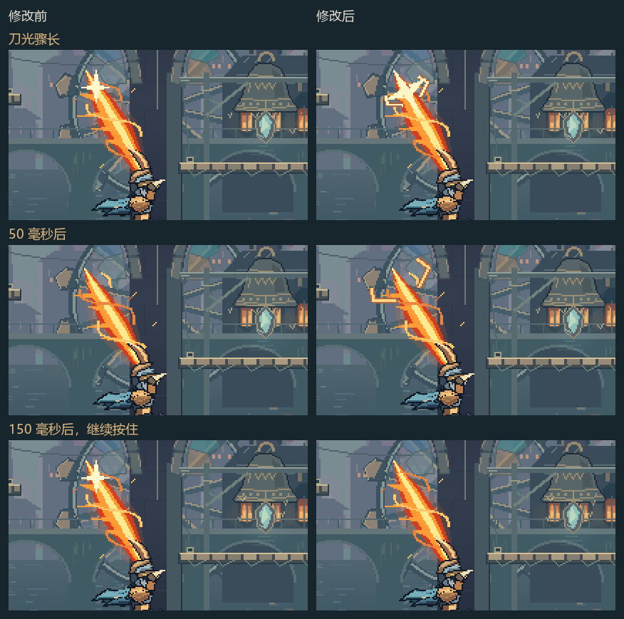

# 吊廊蓄焰斩 · 满蓄与预警

按住 L 约 0.45 秒，长刃出现并响起两记短铜音，这时可以松手。继续持刀会保持长刃与绕刃火带。短按可直接收刀。



[修改前带声片段](before/combat.mp4) · [修改后带声片段](after/combat.mp4) · [弩手预警与命中同帧原图](after/fire-warning.png)

两段视频均为 6.85 秒，共 411 帧。画面取自 1280×720 游戏窗口，视频以 640×360 的逻辑分辨率导出。音轨按实际获准播放的游戏 WAV、音量和被抢占的帧位置重新混合。没有采集系统音频或扬声器输出。截图保留窗口原始像素。

| 片段起点 | 场景 | 实测 |
| --- | --- | --- |
| 0.00 s | 短按取消 | 两版均无点火与挥斩事件 |
| 0.90 s | 长按蓄满再松开 | 新版在满蓄的前 18 个逻辑步各显示三张裂光中的对应帧，随后进入无星芒的持刀循环。只播放一次点火声 |
| 2.87 s | 弩手瞄准时出刀 | 同一采样帧看见火弧和一个预警徽记，游戏依次记录预警、满蓄、释放、命中、弩弹发射与受伤 |
| 4.33 s | 六声道受控压力测试 | 用游戏现有音效占满六个声道，给满蓄信号后立即请求弩手预警。旧版丢弃点火声，新版保留点火与预警，最大同时声源数仍为六 |
| 5.65 s | 关闭闪光并静音，朝左蓄力 | 新版只绘制常态刀光，两版均未播放声音 |

两版六个采样点的时刻、蓄力计数、姿态、镜头横坐标和徽记数量一致。记录同时包含提交到实际绘制函数的图集帧号。[原版事件与声音](before/trace.json) · [新版事件与声音](after/trace.json)

按播放记录复算，编码前 16 位音轨的绝对峰值分别为 20851 和 22607，两个片段均无削波。末段静音的样本值全部为零。该测量不包含声卡和扬声器的处理。

## 性能

Windows 11、RTX 5060 Laptop、Python 3.12.14、Arcade 3.3.3。640×360 逻辑画布，1280×720 窗口，开启垂直同步，双敌重复蓄焰斩，四项反馈均为最高档。各预热后采 752 帧，采样与录屏分别运行。

| 指标 | 修改前 | 修改后 |
| --- | ---: | ---: |
| 平均 FPS | 59.57 | 59.53 |
| 呈现间隔 P95 / P99 | 17.81 / 18.55 ms | 17.61 / 18.25 ms |
| 更新与绘制提交 P95 | 4.87 ms | 4.39 ms |
| 粒子峰值 | 10 | 10 |

上述数据仅描述本机两次采样。低配设备、外放听感及真人能否可靠地同时辨出两种信号仍未验证。[修改前采样](before-timing.json) · [修改后采样](after-timing.json)

## Windows 包

完整解压 `dist/charge-signal/EmberCorridor-Windows-x64.zip` 后双击 `EmberCorridor.exe`。在项目外实际启动两次，读回设置，种子 17 走完五室，验证了暂停、死亡和胜利后重开。打包版与源码版的四张预热帧逐像素一致，58 项资源均在包内。[归档与 SHA-256](installed/distribution.json) · [五室实测](installed/installed.json) · [打包版计时](installed/packaged-timing.json)

## 复验

在项目根目录执行。录制器需要本机的 FFmpeg。

```powershell
.\.venv\Scripts\python.exe -m game --classic
.\.venv\Scripts\python.exe tools/verify_charge_signal.py build/charge-replay --encoder (Get-Command ffmpeg).Source
.\.venv\Scripts\python.exe tools/profile_stage8.py build/charge-timing.json
.\.venv\Scripts\python.exe -m unittest discover -s tests
```
