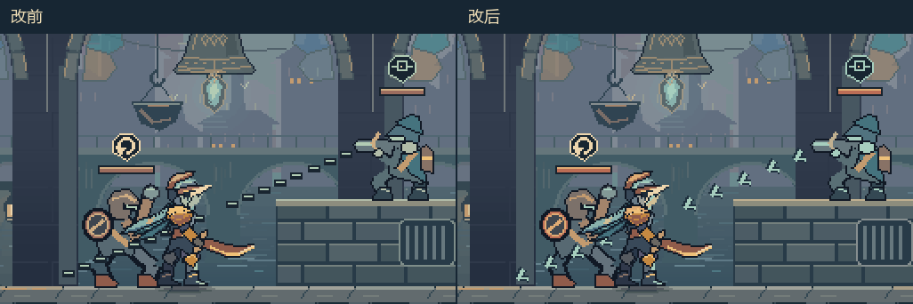

# 西侧绞盘 · 回钩与弩箭交叉

上图裁取两次实机录制的相同区域，按原速并排播放。四段完整镜头均来自 1280×720 游戏窗口，以每秒 30 帧保存为 640×360 无声 GIF。

| 场景和条件 | 改前 | 改后 |
| --- | --- | --- |
| **交叉站位**。在种子 17 第二室把测试用弩手放上西阶座，行者站在两敌之间。两敌同时起手，张开的钩头穿过锁定弹道。 | [完整交锋](before/crossing.gif) · [钩口与瞄线](before/lock.png) | [完整交锋](after/crossing.gif) · [钩口与瞄线](after/lock.png) · [双击从头顶通过](after/pass.png) |
| **正式房间**。使用原生成布局，从入口跑上西阶座引高台弩手出箭，再向左折返。箭先到，回钩紧随其后。 | [从入口开始](before/gallery.gif) · [旧瞄线末端](before/high-aim.png) | [从入口开始](after/gallery.gif) · [新版瞄线](after/high-aim.png) · [反击](after/riposte.png) |

## 画面里改了什么

旧瞄线的矩形短划在交叉处很像链节，弩箭飞过钩口时只有一团横向亮点。新版以青绿色开口箭羽标示射向，弩口在发射前增加一枚刻羽，实际飞出的箭带有顺着弹道的分叉尾羽。瞄线沿真实射程延伸，遇实体就截断。钩口处跳过会重叠的刻羽，钩齿绘在瞄线前；张钩停顿期间，暖铜链箍向手套滑动。两条轨迹仍经过实际危险位置。[相同游戏步放大静帧](comparison.png)

## 出手、躲避与反击

模拟时钟为每秒 120 步。对照使用同一组窗口按键回调，生命、攻击冷却、受击保护、投射物和伤害判定均由正式游戏推进。交叉站位只调整测试初始坐标，行者 x=178，绞工 x=145，弩手 x=300、脚底 y=143。正式布局中的弩手仍在高台 x=493、y=197。

| 对照 | 站定承受 | 翻滚后反击 |
| --- | --- | --- |
| 交叉站位 | 第 63–77 步，张开的钩头与瞄准射线相距不超过 5 个逻辑像素。第 110 步回钩扣 18 血，第 120 步弩箭触发受击保护。 | 第 78 步射箭，第 87 步向右滚。第 100–106 步中，弩箭和钩头的横向范围同时经过翻滚中的行者。第 164 步转身出刀，第 175 步命中，玩家 **100 血**，绞工 **68 → 52**。 |
| 正式房间 | 折返后原地等待，第 360 步弩箭扣 12 血，第 387 步回钩触发受击保护。 | 第 336 步向阶座翻滚，先过箭、再过钩。第 443 步第一刀命中，玩家 **100 血**，绞工 **68 → 52**。 |

固定站位额外试了五个翻滚时刻。第 **68、87、103** 步开始都能满血反击；第 **62** 步滚早，起身时挨打；第 **111** 步按键时，钩头已在上一步命中。这是五次离散输入实测。改前改后的主对照中，四组伤害与攻击事件逐项一致。[改前记录](before/report.json) · [改后记录与五次抽样](after/report.json)

Windows 11、RTX 5060 Laptop、1280×720。独立解压的 EXE 复现了同样的交锋结果，原入口单独对付绞工的回归也通过。55 项单元测试通过。[EXE 双敌验收](installed-crossfire.json) · [单敌回归](installed-solo.json)

## 复现

- 正常游玩可在解压目录运行 `.\EmberCorridor.exe --seed 17`。第二室先上西阶座引箭，随即向入口折返。观察钩口张开和箭的飞向，向西阶座翻滚，再朝左按 J。
- 自动重放全部对照可运行 `.\EmberCorridor.exe --verify-install crossfire-replay --crossfire`，使用新的输出目录。源码对应命令为 `.\.venv\Scripts\python.exe tools/verify_crossfire.py --out build/crossfire-replay`。
- **手工五室真人首玩单列待验收，目前 0 份。** 本轮通过自动按键在实机窗口复验。首次遇敌的真人辨招体验、低配显卡表现仍待验证。
