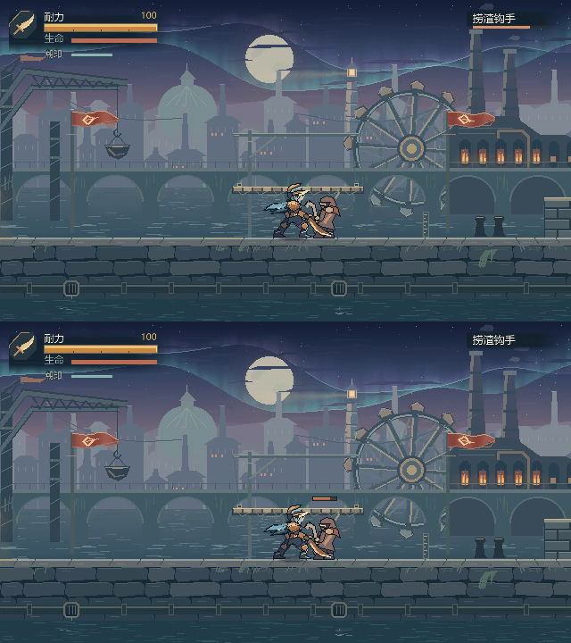

# 栈板下穿、近战拟音与敌方血条

2026-11-21，在 Windows 11 的 1280×720 Arcade 窗口使用独立临时存档。前后均通过游戏窗口的按键回调进入经典退潮门廊，以相同的起点、目标位置和攻击输入录制。两段战斗各 4.2 秒，依次是挥空、三连、落锤。

[旧版带声回放](before/combat.mp4) · [新版带声回放](after/combat.mp4) · [只听音效，先旧后新](melee-ab.wav)。画面来自游戏帧缓冲；音轨按游戏内实际获得播放声道的采样、音量和所在帧重混。扬声器外放听感未验证。

## 盐栈

板面脚底高度为 151，下方地面为 94，单位均为逻辑像素。角色先实际跳上盐栈，再输入第二组按键。以下是 90 个物理更新后的落点。

| 操作 | 修改前 | 修改后 |
| --- | --- | --- |
| S 在前，空格在后 | 地面 | 地面 |
| 同帧，先空格后 S | 原板 | 地面，当帧开始下落 |
| 空格早 25 毫秒 | 原板 | 地面，途中最高 161.62 |
| 改绑上、下方向键，间隔 25 毫秒 | 原板 | 地面 |
| 单按空格，或起跳约 117 毫秒后才按 S | 原板 | 原板 |

[下穿旧版截图](before/platform.png) · [相同时刻新版截图](after/platform.png) · [旧版记录](before/checks.json) · [新版记录](after/checks.json)

## 战斗

短刃三个接触声分别跟随横斩、上挑和突刺的命中事件，重锤使用独立重击。四次接触均在各自攻击动画的第 3 号帧登记。挥空记录只有挥动声。

三敌截图使用游戏内第四室，把守卫置于指定位置和血量以便同框复核。小型射手、钩手、重甲守卫的槽宽分别为 26、28、42 个逻辑像素，守钟人为 54 个。实测覆盖同位置双敌、攻击徽记、离屏与死亡。另将射手置于屏外验证瞄准线仍可进入画面。

[三种体型与预警](after/guards.png) · [半血守钟人](after/boss.png) · [实机验收脚本](../../../tools/verify_deck_audio.py)

## 本机运行

在项目目录执行 `.\.venv\Scripts\python.exe -m game --classic`，或解压本轮 Windows 包后双击 `EmberCorridor.exe`。复核输入与战斗脚本时，用项目解释器运行 `tools/verify_deck_audio.py 输出目录 --verify --encoder ffmpeg.exe的完整路径`，脚本会生成截图、录屏和逐次输入结果。

52 项单元测试通过。Windows 11、RTX 5060 Laptop、1280×720、垂直同步、双敌蓄焰斩场景下，最终 EXE 采样 752 帧，平均 59.48 FPS，帧间隔 P95 为 17.47 ms，更新与绘制提交 P95 为 0.96 ms。低配设备帧耗时及多人试听未验证。[发行包性能原始数据](installed/packaged-timing.json)

最终 ZIP 在项目外解压，清除 PATH 中的 Python 后启动，读入 60 项资源。种子 17 实走五室、暂停、通关及两次重开均通过。自动行程的胜利用时 57.64 秒；阶段 4 仍等待真人首玩样本。[安装包校验与 SHA-256](installed/distribution.json) · [实机事件](installed/installed.json) · [通关画面](installed/victory.png)
