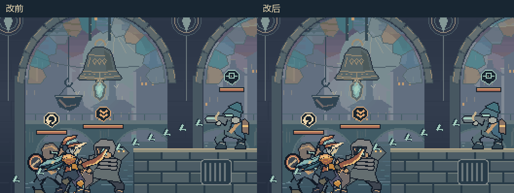

# 西侧绞盘 · 烈焰下的回钩和弩箭

上图放大了两次窗口录像的同一区域。下面的完整镜头保留 HUD，均以每秒 30 帧原速播放，无音轨。源画面为 1280×720，世界画布为 640×360，震动、闪光、粒子均开至最高档。

| 种子 17 第二室的交锋 | 改前 | 改后 |
| --- | --- | --- |
| **正式房间，从入口折返**。上西阶座引高台弩手锁定，滚回地面蓄力，向阶座挥空，保留两种来袭武器。收招后向右翻滚穿过回钩和弩箭，转身第一刀将绞工从 68 血打到 52。 | [完整片段](before/gallery.gif) | [完整片段](after/gallery.gif) |
| **正式房间，朝绞工出刀**。同一路线，落地后向左蓄力。满蓄斩把绞工从 68 血打到 14，打断回钩。随后滚过已发射的弩箭，再用短刃击倒绞工，玩家全程满血。 | [完整片段](before/gallery-hit.gif) | [完整片段](after/gallery-hit.gif) |
| **固定交叉站位**。保留本室三名敌人和地形，行者从 x=166 开始，弩手放在西阶座 (330,143)，重卫在入口地面 (198,94) 接刀。绞工与弩手得以在烈焰命中重卫时继续出手。 | [完整片段](before/crossing.gif) | [完整片段](after/crossing.gif) |
| **同一站位，提前轻按 K**。第 114 步按下，第 115 步松开。旧版未起滚，玩家剩 82 血；新版第 118 步起滚，满血反击。 | [收刀后受击](before/early-tap.gif) | [滚过两击后反击](after/early-tap.gif) |

## 看哪里、什么时候滚

满蓄长刃经过绞工头顶时，徽记仍有独立的暗边。注意钩齿张开后沿链滑动的铜箍，再看弩口的青绿双刻羽。火弧外侧保持连续，橙色内弧的两处断口让箭羽露出来；命中后首帧出现白芯，接下来是弧光和向前溅出的熔屑。短刃落回手边时可输入翻滚。[满蓄原图](after/charge.png) · [接触火花](after/impact.png) · [弩口前的火弧对照](arc-comparison.png) · [收招原图](after/recovery.png)

在固定站位，重卫受焰斩后由 98 血降至 44。第 66–74 步采样到焰斩命中停顿与两敌前摇同时存在；第 66–87 步，钩齿张开且弩手仍在瞄准。第 119 步翻滚，第 120–126 步身形低于经过的钩齿，第 127–131 步与箭的横坐标交会，第 210 步短刃反击命中。对照分支在原地完成同一焰斩，第 122 步被回钩打掉 18 血，随后到达的弩箭触发受击保护。

正常时序的五组分支在前后版本有相同的攻击事件、受击结果和穿越时刻。提前轻按分支用于复现输入修复。战斗每秒 120 步，允许预输入的末尾 6 步为 50 毫秒，翻滚从原有收招结束时开始。手工五室真人首玩继续单列待验收，当前记录 0 份；本轮按键由实机验收程序发送。[改前逐步记录](before/report.json) · [改后逐步记录](after/report.json)

## 运行验证

Windows 11、RTX 5060 Laptop、Python 3.12 / Arcade。固定交叉站位取 109 个显示帧，每帧计入最后一个 120 Hz 更新步、绘制和 GPU 同步。源码改前中位数 1.33 ms、P95 1.67 ms，改后中位数 1.30 ms、P95 1.68 ms。该取样不含另一个模拟步、换帧等待和截图编码。低配设备与真人初见辨招尚未验证。

独立解压的 Windows EXE 复现了全部交锋分支，也通过了上一轮普通双敌交锋回归。57 项单元测试通过，覆盖最后六步的输入边界、保留翻滚方向、受击清除与暂停清除。[EXE 焰斩记录](installed-flame-crossfire.json) · [普通双敌回归](installed-crossfire.json)

- 正常游玩可在解压目录运行 `.\EmberCorridor.exe --seed 17`，或在源码目录运行 `.\.venv\Scripts\python.exe -m game --seed 17`。进第二室后上西阶座引箭，向左滚下台阶。落地时持短刃按住 L，刀光伸长后松开，收刀时按方向与 K，翻过后转身按 J。
- 自动重放可在解压目录运行 `.\EmberCorridor.exe --verify-install flame-replay --flame-crossfire`，输出目录须为新名称。源码对应命令为 `.\.venv\Scripts\python.exe tools/verify_flame_crossfire.py --out build/flame-replay`。改前片段由同一验收脚本在提交 `dc4b042` 的游戏代码与资产上以 `--baseline` 模式录制。
