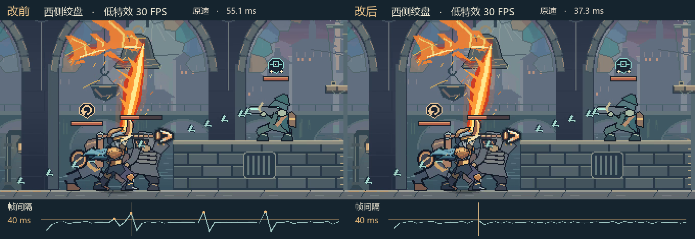

# 西侧绞盘 · 30 帧下的三个长帧

[播放改前改后并排实录](comparison.mp4) · [改前完整窗口](before/crossing.mp4) · [改后完整窗口](after/crossing.mp4)

左侧为提交 `725b603` 的游戏，右侧为本轮修复版。两段都取各版本第一场录屏。先原速、后半速，底部曲线取自对应那场的实际换帧时间，金线标出 40 ms。每个画面的停留时间按实际测量值就近量化到 1/120 秒；并排视频以 60 fps 输出。原片无音轨。

## 长帧发生在哪里

种子 17，沿用上轮西侧绞盘的固定交叉站位。行者在 x=166，弩手在西阶座 (330,143)，重卫在地面 (198,94) 接住满蓄斩，绞工从原站位收钩。改前八次交锋里有三个可重复的尖峰。表中范围来自同一画面在八场中的最小值与最大值，单位均为毫秒。

| 截至哪个 120 Hz 逻辑步 | 首次记入存档的动作 | 改前游戏线程存档耗时 | 改后游戏线程提交耗时 | 改后换帧间隔 |
| --- | --- | ---: | ---: | ---: |
| 68 | 攻击，满蓄斩命中重卫 | 16.85–58.01 | 0.034–0.041 | 34.17–37.75 |
| 120 | 翻滚，避开回钩 | 13.63–42.18 | 0.032–0.040 | 34.12–36.98 |
| 164 | 向左走，准备反击 | 13.15–32.57 | 0.034–0.174 | 36.53–37.31 |

教学每增加一种已学动作，原来的窗口更新都要等待存档加锁、读回、写备份和主档，两次刷新到磁盘后再继续。现在先在内存中记住动作，一个后台线程按顺序完成原有的原子写入，正常退出会等写入完成。设置、改键和解锁仍可合并先前的教学进度。测试还覆盖了写入失败、重试、两个窗口合并、恢复备份，以及上次写入尚未结束时又学会一个动作。

中途试过第一次命中时才启动写盘线程。此时第 68 步的存档耗时已经变短，但第 72 步的换帧间隔反而达到 113–167 ms。超时栈采样落在环境动画切帧的 OpenGL 图集写入；试着提前上传环境帧，等待又出现在绘制阶段。把线程提前到打开游戏读取存档时启动后，用原有渲染路径复跑，第 72 步尖峰消失。驱动内部的等待机制未验证。

## 录屏与不录屏

Windows 11、RTX 5060 Laptop GPU、Python 3.12、Arcade 3.3.3。窗口 1280×720、逻辑画布 640×360；档位依次为震动 0、闪光 0、音量 2、粒子 1。每个版本跑四对，每场都是新进程、独立新档，交替先开或先关录屏。每场 54 帧，共 53 个相邻换帧间隔，每种条件得到 212 个间隔。P95/P99 按该条件的所有间隔计算。

| 条件 | 间隔中位数 | 间隔 P95 | 间隔 P99 | 最长间隔 | 超过 40 ms | 每帧工作 P95 |
| --- | ---: | ---: | ---: | ---: | ---: | ---: |
| 改前，录屏 | 33.00 | 53.98 | 66.14 | 83.13 | 13 / 212 | 34.41 |
| 改后，录屏 | 33.20 | 36.69 | 37.49 | 37.81 | 0 / 212 | 16.23 |
| 改前，不录屏 | 33.17 | 47.56 | 70.64 | 94.61 | 12 / 212 | 19.61 |
| 改后，不录屏 | 33.34 | 36.29 | 37.00 | 37.15 | 0 / 212 | 10.61 |

沿用上轮单时钟重放，关闭垂直同步，每次窗口更新推进四个物理步。帧间隔取相邻两次 `flip()` 返回的时间差；每帧工作从更新开始到换帧返回，均包含 GPU 同步。录屏组逐帧读取完整窗口再最近邻缩小，编码放在战斗结束后；不录屏组跳过读回和缩放。录屏读回与处理的中位耗时，改前 4.64 ms、改后 5.59 ms。原始 CSV 中 `save`、`sound`、`sync_pose` 等为嵌套计时。这些数据仅代表这段交锋，显示器实际扫描时刻、外部录屏软件和低配硬件未验证。[改前逐帧 CSV](before/frames.csv) · [改后逐帧 CSV](after/frames.csv) · [改前完整记录](before/summary.json) · [改后完整记录](after/summary.json)

## 收刀、躲避和反击

改后八场里，K 的按下与松开都发生在第 112 步后的同一帧间隔内，实测按住 10.04–10.64 ms。第 117 步起滚，钩头从上方回收，随后箭矢穿过原站位；第 208 步转身首刀命中，绞工从 68 血降到 52，行者保住 100 血。退出、重开临时存档，攻击、翻滚和移动三条教学均已保存。第一对录屏在第 60、64、84、112、212 步保留的原分辨率截图，改前改后文件校验和逐张一致。手工五室真人首玩继续单列待验收，记录 0 份。

## 复现

59 项单元测试通过。Windows ZIP 已在项目外解压，并在 PATH 仅含系统目录的条件下运行。解压版录屏与不录屏各复跑一场，最长间隔分别为 35.87 / 35.46 ms。上一轮正式入口的 30/60 帧收刀翻滚、固定交叉与过早按键对照也通过。ZIP SHA-256 为 `14693f1cfc9ddf2815ec2c1118f0f17e161a475305ee3c03eed48852a2529f54`。[解压版交锋记录](exe.json) · [录屏帧耗](exe-on.csv) · [不录屏帧耗](exe-off.csv)

- 正常启动为 `.\EmberCorridor.exe --seed 17 --fps 30`，源码为 `.\.venv\Scripts\python.exe -m game --seed 17 --fps 30`。从暂停设置将闪光和震动关掉、粒子调至一档。
- 源码计时入口为 `.\.venv\Scripts\python.exe tools/profile_crossing.py --out build/frame-sample`。可加 `--encoder <ffmpeg.exe 的路径>` 输出 MP4。脚本固定站位、校验游戏事件、退出后回读存档，结果写入所选目录；建议使用新目录。
- Windows 试玩包解压后运行 `.\EmberCorridor.exe --verify-install frame-check --frame-pacing`，在新目录中查看两种条件的 CSV。另可运行 `.\EmberCorridor.exe --verify-install cadence-check --low-cadence` 重放正式房间的 30/60 帧与过早按键对照。
