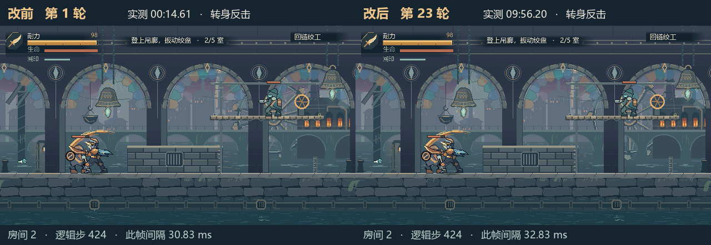

# 种子 17 · 西侧绞盘的连续过门与重开

[首轮与末段同机位对照](comparison.mp4) · [改前首轮](before/first.mp4) · [修复版首轮](after/first.mp4) · [修复版末轮](after/late.mp4)

## 实际路线与计时

每次都持短刃从退潮门廊出生，沿正式关卡清掉守卫，在东门恢复耐力，按 E 进西侧绞盘。房间没有替换敌人，也没有改动玩家或敌人的坐标、血量。进门后登西阶引箭、滚下台阶蓄力，向阶座出刀，让回钩与箭同时逼近。收刀时在一次画面更新之间按下并松开 K，翻滚后转身用短刃反击。验完反击后留在敌人攻击范围内，等正常死亡再按 R。整段走查只使用一个窗口、一个游戏进程和一个新建的临时存档。

实测窗口 1280×720，逻辑画布 640×360，震动 0、闪光 0、音量 2、粒子 1。脚本按真实时间驱动生产窗口的键盘、更新、绘制及换帧回调，关闭垂直同步，每帧推进四个 120 Hz 逻辑步。相邻两次换帧返回的时间差包含等待、输入、更新、绘制、GPU 同步以及选段读回。首个间隔从标题画面换帧算到按 Enter 后第一帧。CSV 中的 record_run、start_room、raster、resize 等为嵌套计时，不能与外层输入或绘制时间重复相加。窗口外的显示器扫描、物理键盘延迟未测。

短片按连续采到的画面以 30 FPS 原速播放，等待敌人击倒的中段有切点。并排片段为相同逻辑步的原窗口画面，标注对应场次的经过时间和原始帧间隔；某帧的停留时间应以 CSV 为准。录屏只覆盖选定轮次和动作，编码在实测结束后进行。

## 定位与修改

基线版本为 `3336dca`，同一进程实跑 79.37 秒、2380 帧，3 次过门和 3 次死亡重开。第 2、3 次按 R 的间隔分别为 63.00、60.56 ms，单是写 last-route.json 就占 28.38、24.64 ms。这份路线记录现在由开局已启动的后台线程按提交顺序原子写入，输入回调只提交快照；退出会等最后一份写完。路线写失败时保留已有文件，游戏显示提示，正常退出再重试。教学主档和备份仍沿用原有存档机制。

另一帧发生在首轮西侧绞盘第 676 步，间隔 53.49 ms，姿态同步 19.27 ms，其中共享纹理图集扩容 18.92 ms。独立容量探查观察到从 4096×4096 扩到 8192×8192。只预留 4096 方形仍会在第 292 步扩容。战役窗口现从 4096×6144 起步，并按设备上限缩小。按 RGBA8 计算，这张图集为 96 MiB，原先扩容后的方形为 256 MiB；这些是该纹理的名义容量，整卡显存用量未测。练习场沿用原容量。

## 十分钟实测

Windows 本机，NVIDIA GeForce RTX 5060 Laptop GPU。两次测量使用同一套走法。基线跑 3 轮定位故障，修改后跑 23 轮查找罕见尖峰，两列的观测时长不同。

| 同一机位的指标 | 修改前 | 修改后 |
| --- | ---: | ---: |
| 墙钟时长 / 画面帧 | 79.365 s / 2,380 | 608.070 s / 18,240 |
| 过门 / 死亡重开 / 躲开后反击 | 3 / 3 / 3 | 23 / 23 / 23 |
| 帧间隔中位 / P95 / P99 | 33.33 / 34.44 / 35.97 ms | 33.33 / 34.37 / 35.10 ms |
| 最慢帧 / 超过 40 ms 的帧数 | 63.00 ms / 7 | 118.70 ms / 9 |
| R 重开中位 / 最慢 | 60.56 / 63.00 ms | 35.79 / 37.29 ms |
| E 过门中位 / 最慢 | 35.76 / 46.43 ms | 35.80 / 45.67 ms |
| 西侧绞盘第 676 步最慢 | 53.49 ms | 34.32 ms |

修改后仅首次过门超过 40 ms，随后 22 次最多 36.82 ms。主线程每次 R 提交路线快照耗时 0.041–0.130 ms。24 次实际路线写入（含启动）耗时 3.17–17.05 ms，4 次教学存档耗时 7.38–12.42 ms，均在后台线程。退出后重新读盘，种子、房间序列、四项已学操作和低特效设置均一致。检查的整段交锋中图集扩容和重排次数均为零。

双敌交锋的 23 次收招轻按 K 持续 7.643–8.315 ms，按下与松开落在两次画面更新之间。第 332 逻辑步起滚，回钩在 332–337 步穿过玩家位置，弩箭在 344–351 步穿过。每次都在第 420 步转身命中，绞工生命从 68 降到 52，玩家从进门到反击结束保持 100 生命。这里验证的是游戏窗口输入回调，物理键盘和真人反应时间未验证。

## 修改后最慢的五帧

| 帧号 | 场合 | 间隔 | 当帧实际耗时 |
| ---: | --- | ---: | --- |
| 5982 | 3:19.49，第 8 轮绞盘第 396 步，翻滚后反击前 | 118.697 ms | 游戏绘制回调 89.470 ms，逻辑更新 0.314 ms，显式 GPU 等待 0.205 ms。无读屏、存档重叠、图集操作或 Python GC。 |
| 1 | 标题确认后的首帧 | 53.150 ms | 首帧还包含目标帧的等待，窗口事件处理 7.731 ms，绘制 11.107 ms。 |
| 333 | 首次按 E 过门，开启画面采集 | 45.665 ms | 建房 5.721 ms，绘制 8.169 ms，画面读回 5.296 ms。本帧含 5.249 ms 纹理上传。 |
| 23 | 首轮门廊第 92 步 | 44.919 ms | 窗口事件处理 8.316 ms，绘制 6.757 ms。 |
| 4979 | 第 7 轮门廊第 884 步 | 43.784 ms | 窗口事件处理 5.939 ms，绘制 7.899 ms。 |

采集的 579 帧中有 2 帧超过 40 ms，其余 17,661 帧中有 7 帧超过 40 ms。采集集中在过门、交锋及重开片段，两个样本的场景分布不同。未采集的第 5982 帧仅有逐帧记录。两份原始 CSV 的首帧嵌套计数含标题预绘制，因此上表首帧仅使用独立的外层计时。复测脚本已在第一帧前清零这些嵌套计数。

随后另开一局，在每轮绞盘第 320–444 步对绘制调用采样，按真实 30 帧再走 8 轮、211.57 秒。第 8 轮同一逻辑步的间隔为 35.025 ms（这次有读屏）。相似停顿出现在第 6 轮门廊第 44 步，长达 114.542 ms，其中绘制 84.732 ms，没有读屏和图集扩容。停顿能跨房间出现，不能归为某次反击的固定招式开销。[独立复跑逐帧 CSV](diagnostics/replay.csv.gz)

第三次独立运行给每帧绘制加了函数级计时。211.51 秒、8 轮、6,345 帧中，进入游戏后绘制回调最长 15.652 ms，第 5982 帧间隔 32.974 ms。唯一超过 25 ms 的绘制是计时开始前的标题预绘制。加采样会改变执行时序，这一趟没有捕获先前约 85–89 ms 的绘制停顿；具体阻塞在哪一次图形调用、驱动内部或线程调度仍未验证。保留源码采样入口 `tools/trace_gallery_draw.py --out build/my-draw-trace --seconds 600`，供后续扩大样本。[函数级采样记录](diagnostics/draw-calls.json) · [该轮逐帧 CSV](diagnostics/profiled.csv.gz)

[修改前逐帧 CSV](before/frames.csv.gz) · [修改后逐帧 CSV](after/frames.csv.gz) · [修改前存档、动作和转场记录](before/report.json) · [修改后存档、动作和转场记录](after/report.json)

手工五室真人首玩继续单列待验收，已收到 0 份记录。低配显卡上的纹理预算和十分钟帧耗未验证。

## 本机复现

61 项单元测试通过，含后台路线写入顺序、退出前排空和失败重试。

解压 Windows 包，在游戏目录运行 `.\EmberCorridor.exe --seed 17 --fps 30`。从暂停设置把震动、闪光调到 0，粒子调到 1，即可自己走这条路线。

要重复同一组输入并留下逐帧数据，运行 `.\EmberCorridor.exe --verify-install soak-check --gallery-soak`，输出目录需为新目录。源码验收命令为 `.\.venv\Scripts\python.exe tools/soak_gallery.py --out build/my-soak --seconds 600`，可加 `--encoder <ffmpeg.exe 路径>` 输出 MP4。复测会使用临时存档，在满十分钟后的下一次死亡重开结束。

Windows x64 试玩 ZIP 已在项目外解压，测试进程的 PATH 仅含系统目录。解压版连续完成两轮同样的过门、轻按 K、反击和死亡重开，五组 30/60 帧及过早按键对照保留了原来的战斗事件。另用正常 Arcade 事件循环驱动种子 17 的五室，在低特效 30 帧下启动、暂停、通关和重开，61 项资源与清单相符。图集从启动到五室结束仍为 4096×6144。ZIP SHA-256 为 `8ef755647d6ae61a905585fc1e383437946f7cba94b7b718d95e959beef738d5`。[解压版两轮交锋](exe-short.json) · [收招对照](exe-crossfire.json) · [五室、音效与资源记录](exe-tour.json)
