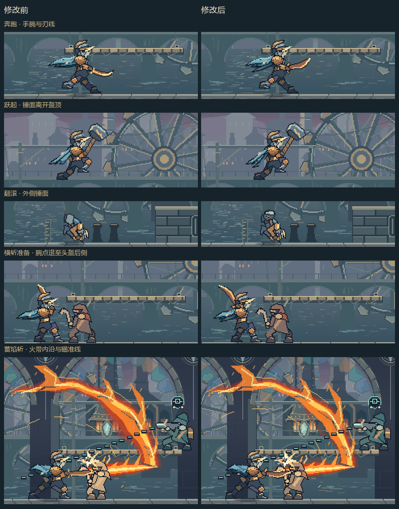

# 持械动作与近战反馈 · 2026-11-21



画面来自 Windows 上的 Arcade 游戏窗口，逻辑画布 640×360，窗口 1280×720。对照图在原始截图中裁取同一矩形，没有插帧或锐化。25 对原图逐项核对了采样帧、主角坐标、朝向、横向镜头、敌方生命和预警徽记数量。

| 实机场景 | 修改前 | 修改后 |
| --- | --- | --- |
| 向右奔跑 | [完整窗口](before/motion-18.png) | [完整窗口](after/motion-18.png) |
| 跃起收刀 | [完整窗口](before/motion-45.png) | [完整窗口](after/motion-45.png) |
| 腾空持锤 | [完整窗口](before/hammer-45.png) | [完整窗口](after/hammer-45.png) |
| 横斩准备 | [完整窗口](before/cut-2.png) | [完整窗口](after/cut-2.png) |
| 重锤翻滚 | [完整窗口](before/hammer-99.png) | [完整窗口](after/hammer-99.png) |
| 冲刺出刀 | [完整窗口](before/thrust-4.png) | [完整窗口](after/thrust-4.png) |
| 火弧、命中与弩手预警重叠 | [完整窗口](before/fire-warning.png) | [完整窗口](after/fire-warning.png) |
| 门廊移动、重击、吊廊蓄焰斩 | [动态片段](before/playback.gif) | [动态片段](after/playback.gif) |

## 观察与实测

- 短刃在摆臂、跃起和落地时转腕。重锤起跳收向肩上，落地压低，翻滚锤面伸出靴外。各帧沿用脚底锚点与腕部插槽。两把武器朝左右分别播放站立、奔跑、起跳、下落、落地及翻滚，24 组均覆盖全部移动帧。[逐帧记录](cycles.json)
- 近战沿用原有伤害、位移和 120 Hz 判定。四种普通攻击各自观察到七帧。帧索引 0–2 准备，3–4 可命中，5–6 后摇。捕捉器核验实际命中事件均在有效帧内，单一挥击对同一目标只结算一次。为逐帧对照，单招镜头直接选入上挑、突刺；另用连续按键在游戏窗口走完整套三连击。[独立出招记录](after/playback.json) · [真实输入连击](chain/action.gif) · [敌方生命变化](chain/samples.json)
- 满蓄状态的刀光跳长后有三帧火带绕刃，挥出时沿刀尖展开。后摇的火光加快衰减。重锤命中向前压出扁弧，火花从接触点发散。冷色瞄线经过面甲的部分留空，弩手头顶的徽记仍然可见。[满蓄实拍](after/full-charge.png) · [强特效原图](after/fire-warning.png)
- 钟灯透光落在下方灯笼架上，水轮只有转进月光一侧的斗沿出现湿边。实机遍历了 32 帧天幕、24 帧水面、24 帧水轮及五室装置各 20 帧。[五室片段](harbour/rooms.gif) · [播放覆盖](harbour/animation.json)
- 清单中 34 张 PNG、3 份图集描述和 20 段 WAV 全部存在并成功解码。实机捕捉到 13 种音效的播放状态。轻击在接触后 8 ms 叠入短促的降调金属刮擦；扬声器的主观层次未验证。[轻击 WAV](../../../assets/combat/audio/hit.wav)

## 帧耗时

同一台 Windows 11 机器，RTX 5060 Laptop、Python 3.12.14、Arcade 3.3.3，垂直同步开启。双敌房间重复蓄焰斩，抖动、闪光、音量和粒子均为最高档。各自预热后采 752 帧，计时期间不截屏。提交耗时包括 CPU 更新与绘制提交。呈现间隔包含同步等待。

| 指标 | 修改前 | 修改后 |
| --- | ---: | ---: |
| 平均 FPS | 59.60 | 59.58 |
| 呈现间隔中位数 | 16.75 ms | 16.76 ms |
| 呈现间隔 P95 / P99 | 17.66 / 18.11 ms | 17.55 / 17.96 ms |
| 更新与绘制提交 P95 / P99 | 4.27 / 4.78 ms | 4.13 / 4.59 ms |
| 粒子峰值 | 10 | 10 |

上述差值仅描述这两次采样。未测独立 GPU 执行耗时、低配机或关同步时的帧率上限。[修改前数据](before-timing.json) · [修改后数据](after-timing.json)

## Windows 交付

本轮 ZIP 位于 `dist/quay-strike/EmberCorridor-Windows-x64.zip`，SHA-256 为 `fa80db3852819fcef3694d722af6095f58c2a47d9e6a71cddf59be8466d7e5ac`。实际在项目外解压并启动，两次普通启动完成设置读回，种子 17 通过五室、暂停、胜利及死亡重开。四张预热采样图的像素哈希与最终源码版本逐张一致。发行包呈现间隔 P95 为 17.39 ms。[归档校验](installed/distribution.json) · [五室运行记录](installed/installed.json) · [发行包计时](installed/packaged-timing.json) · [胜利画面](installed/victory.png)

## 在项目根目录复验

```powershell
.\.venv\Scripts\python.exe -m game --classic
.\.venv\Scripts\python.exe tools/verify_quay_combat.py build/quay-replay --baseline docs/verification/quay-strike/before
.\.venv\Scripts\python.exe tools/verify_clarity.py build/quay-chain
.\.venv\Scripts\python.exe tools/profile_stage8.py build/quay-timing.json
.\.venv\Scripts\python.exe -m unittest discover -s tests
```

进入门廊后用 A / D 来回跑动、空格跳跃、K 翻滚，1 / 2 切换武器。靠近钩手用 J 连击。装备弯刃长按 L，待刀光突然伸长后松开，在有弩手的房间观察火光内侧和敌方瞄线。验收 GIF 无声。
