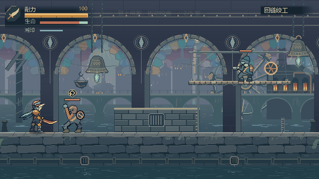
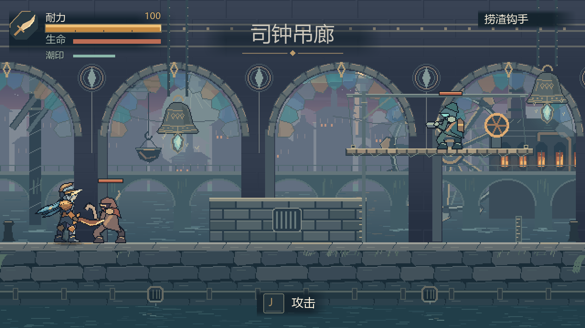
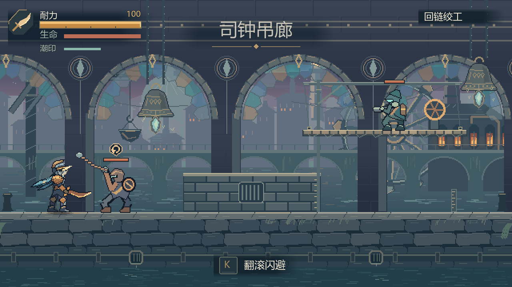

# 阶段 7 · 西侧绞盘的回链绞工

种子 **17** 的第二室是司钟吊廊的「西侧绞盘」。入口的守卫先将闭合的钩头抛过行者头顶。看到钩齿张开、链条拉直，朝绞工按 **K** 翻滚。等他弯腰把钩收回膝旁，转身按 **J** 即可反击。

| 同一入口、同一机位，进房后第 16 个更新画面 | 新版 |
| --- | --- |
|  |  |

## 两次交锋

| 应对 | 观察到的结果 | 窗口原图 |
| --- | --- | --- |
| 站在出生点等待 | 第 1 步出现预警，放链和拉直期间生命为 100。第 105 步，回收的钩头在肩高处命中，生命降至 82。整次攻击只受伤一次。 | [张开的钩齿](open.png) · [站定受击](contact.png) |
| 面朝绞工翻滚 | 第 104 步后按 K。第 106、108 步，玩家与钩头在水平方向重叠，翻滚无敌尚未生效；钩下缘距地 48 像素，压低后身高 42 像素，留出 6 像素净空。玩家全程满血。 | [从钩头下方通过](dodge.png) |
| 从另一侧转身反击 | 绞工在第 128 步的窗口采样中已进入收具姿态。第 166 步后按 J，第 178 步短刃第一刀命中，绞工生命从 68 降到 52。 | [收具空当](slack.png) · [第一刀命中](counter.png) |

战斗以每秒 120 步更新。前摇 0.80 秒，其中末尾约 0.28 秒保持钩齿张开；随后钩头用 0.25 秒收回，绞工有 0.80 秒后摇。源码与解压后的 Windows EXE 使用独立临时存档，在正式战役加载相同房间，从入口默认坐标开始，以窗口按键回调驱动。两次对照均保留本室其余守卫、地形、碰撞和伤害规则。预警音已在播放列表中检测到，GIF 无音轨。[源码实测记录](duel.json) · [EXE 实测记录](installed-chain.json)

Windows 11、RTX 5060 Laptop、1280×720 窗口。EXE 站定分支采样 66 帧，更新、绘制和 GPU 同步耗时中位数 1.05 ms、P95 1.87 ms。翻滚反击分支采样 91 帧，中位数 0.94 ms、P95 2.31 ms。采样不含换帧等待和截图编码。多敌同时出招与低配显卡上的回链可读性仍待实测。

同一 ZIP 在项目外解压后，还从第一室走到了第五室，沿途清场、开门、扳动绞盘并鸣钟。游戏内用时 57.408 秒，暂停、胜利重开、死亡重开和链响播放均已记录。55 项单元测试全部通过。61 项资源已核对，旧守卫图集的四行像素逐字节一致，新增一行有 10 个不同姿态。[发行包随机五室记录](installed-route.json)

## 复现

- 在解压目录运行 `.\EmberCorridor.exe --seed 17`，或在源码项目运行 `.\.venv\Scripts\python.exe -m game --seed 17`，从门廊进入第二室。
- 源码自动对照可运行 `.\.venv\Scripts\python.exe tools/verify_return_chain.py --out build/chain-replay`。发行包对应命令为 `.\EmberCorridor.exe --verify-install chain-replay --return-chain`，输出目录需使用新名称。
- **手工五室真人首玩单列待验收，现有记录 0 份。** 本轮没有组织真人辨招或首玩计时。
